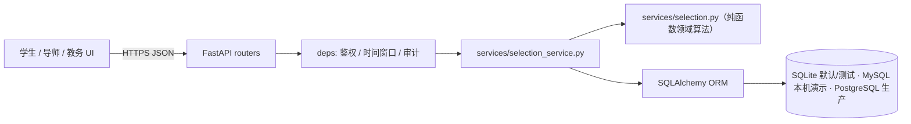
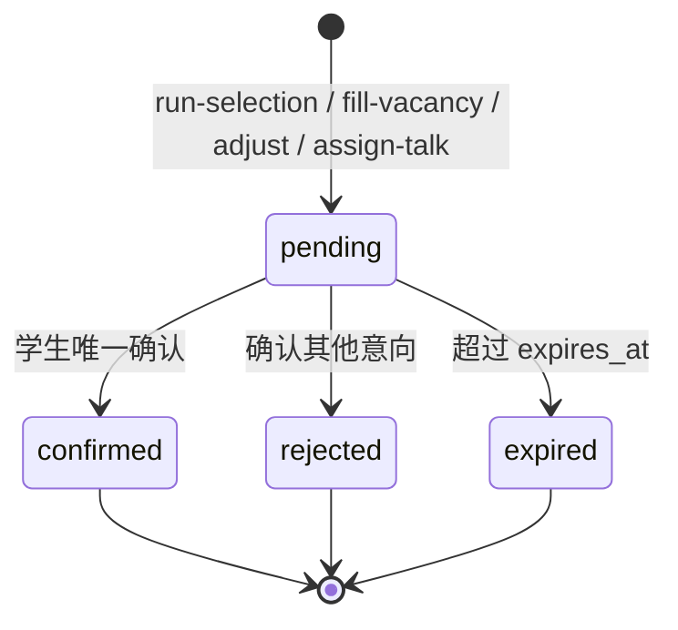

# 系统设计说明书

## 1. 架构

分层架构：`API (FastAPI)` → `Service（领域算法 + 编排）` → `Repository (SQLAlchemy)` → `SQLite（默认/测试）/ MySQL（本机演示）/ PostgreSQL（生产）`。



设计原则：
- **领域与持久化解耦**：`selection.py` 不含任何 ORM/IO，可直接单测；`selection_service.py` 只做取数、落库与审计。
- **统一响应**：`{code, message, data}`，业务异常由 `AppError` 集中转换。
- **可审计**：所有名单生成、改分、确认、递补、调剂、公示动作写 `audit_logs`。

## 2. 数据模型（ER 摘要）

| 表 | 关键字段 | 说明 |
|---|---|---|
| `users` | id, student_no(uniq), name, role, password_hash, lab_id, obey_internal, obey_cross | 学生/导师/教务/监督四类角色 |
| `labs` | id, name(uniq), capacity, direction, open_day_at | 实训室与容量 |
| `mentors` | id, lab_id, name, quota, requirement, is_active | 导师名额，合计不得超容量 |
| `rounds` | id, name, kind, round_no, starts_at, ends_at | 轮次与时间窗口 |
| `intentions` | id, student_id, mentor_id, round_id, priority, uniq(student,mentor,round) | 平行志愿，最多 3 个 |
| `interviews` | id, student_id, mentor_id, round_id, 四维分, decision, remark, scored_by | 统一面试评分 |
| `offers` | id, student_id, mentor_id, round_id, offer_type, status, expires_at, confirmed_at | 拟录取/递补/调剂意向 |
| `publications` | id, round_id, title, content, status, published_at | 公示 |
| `appeals` | id, student_id, publication_id, content, status, reply, handled_at | 实名异议与复核 |
| `audit_logs` | id, actor, action, entity, entity_id, before_json, after_json, ip | 操作留痕 |

## 3. 状态机

### Offer 状态



- 仅 1 个 `pending`：系统允许无参确认（自动确认）。
- ≥2 个 `pending`：必须显式传 `mentor_id`，否则返回 `4001`。
- 逾期：`expire-offers` 批量释放，名额回流至递补池。
- 幂等：重复确认同一导师返回既有记录，不重复扣减名额。

### 学生录取阶段

`not_applied → applied → interviewed → offered → enrolled`（另有 `supplement` / `adjust` 分支）。

## 4. 核心算法

| 函数 | 职责 |
|---|---|
| `total_score` | 四维加总并裁剪到 100 分（25/20/35/20） |
| `rank_interviews` | 按总分降序、学号升序打破平局；产出 `proposed → internal_candidate → waitlist → rejected` |
| `confirm_unique_offer` | 单意向自动确认、多意向强制选择、逾期拒绝、幂等 |
| `expire_pending_offers` | 释放逾期意向 |
| `available_quota` | 剩余名额 = min(quota, capacity) − (confirmed + pending) |
| `next_waitlist_candidate` | 按顺位补录一名，跳过已确认/待确认 |
| `plan_adjustments` | 内部调剂 → 全院跨实训室调剂 → 约谈名单 |

名额与容量双约束：导师名额永不超过实训室容量，避免超录。

## 5. API 约定

统一响应：

```json
{ "code": 0, "message": "ok", "data": {} }
```

| 错误码 | HTTP | 含义 |
|---|---|---|
| 1001 | 422 | 参数校验失败（`data` 含字段定位） |
| 2001 | 401 | 未登录/令牌无效或过期 |
| 4003 | 403 | 角色无权限 |
| 4004 | 404 | 资源不存在 |
| 3001 | 409 | 不在开放时间窗口 |
| 4001 | 409 | 名额不足、重复提交或状态冲突 |
| 5000 | 500 | 服务端/数据库错误 |

鉴权：`Authorization: Bearer <token>`（HS256 JWT，`sub` 为用户 id）。

## 6. 测试策略

- **单元测试**：`tests/test_selection.py` 覆盖分数裁剪、平局、多意向确认、幂等、逾期、递补、调剂优先级。
- **接口测试**：`tests/test_api.py` 使用 TestClient + 临时 SQLite，覆盖注册登录、越权、志愿上限、选拔幂等、dry-run、补录、调剂、公示申诉、审计。
- **端到端剧本**：`scripts/demo_flow.py` 串起 7 个阶段的真实调用。

## 7. 部署

| 环境 | 配置 |
|---|---|
| 开发 | SQLite（`data/app.db`）或 MySQL 8（见 README）+ `uvicorn --reload` |
| 生产 | PostgreSQL、反向代理 + HTTPS、Redis 限流、集中日志、每日备份与审计归档 |

关键环境变量：`DATABASE_URL`、`SECRET_KEY`、`DEMO_MODE`、`ENFORCE_TIME_WINDOW`、`CORS_ORIGINS`。

## 8. 演进路线

1. 接入学院统一身份认证（OIDC），移除演示登录。
2. 面试评分增加多评委加权与仲裁记录。
3. 名额与确认使用行级锁/乐观锁，支撑 1000 并发。
4. 结果对账与数据导出（Excel/PDF 公示单）。
